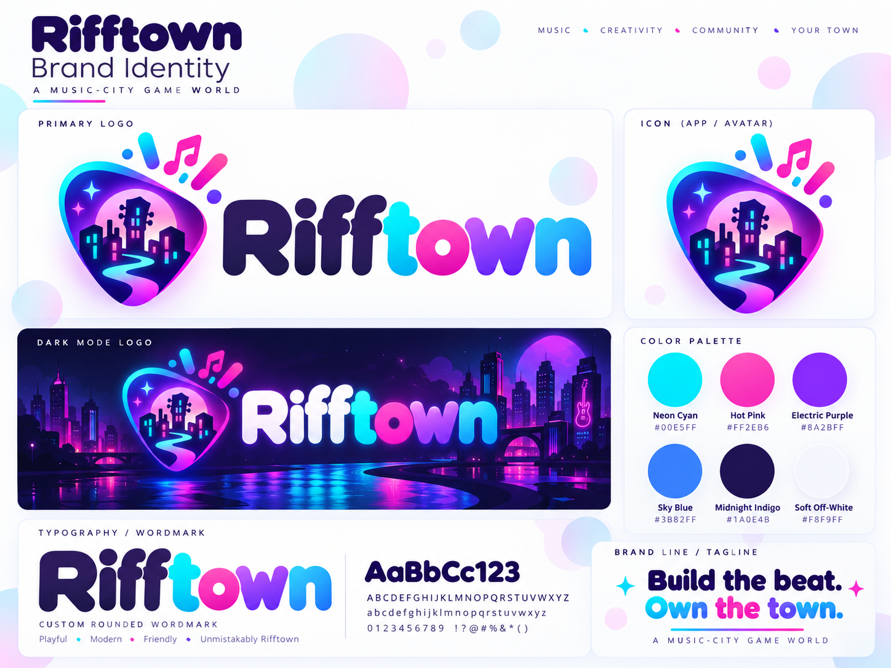

# Rifftown marka rehberi

**Şehir senin. Sahne senin.** · *Your City. Your Stage.*

## Logo

| Dosya | Ne için |
|---|---|
| `app/assets/images/logo.png` | Penalı tam logo, açık zemin (saydam PNG) |
| `app/assets/images/logo-dark.png` | Karanlık zemin: "Riff" yazısı beyaz |
| `app/assets/images/pick.png` | Sadece pena simgesi (saydam) |
| `app/assets/images/icon.png` | Uygulama simgesi (1024 × 1024, kırık beyaz zemin) |
| `app/assets/images/android-icon-*.png` | Android uyarlanabilir simge (ön plan, zemin, tek renk) |
| `app/assets/images/splash-icon.png` | Açılış ekranı |
| `app/assets/images/notification-icon.png` | Android bildirim simgesi (beyaz siluet) |
| `app/assets/images/icon-512.png` | Google Play mağaza simgesi |

Simgeler `docs/brand-board.png` panosundaki logodan üretildi. Logonun vektör (SVG) ya da daha yüksek çözünürlüklü bir sürümü elinize geçerse aynı dosya adlarıyla değiştirin. Mağaza öne çıkan görselleri için en az 2048 px'lik bir kaynak önerilir.

## Renkler

| Ad | Kod | Kullanım |
|---|---|---|
| Neon Cyan | `#00E5FF` | Karanlık temada ilerleme ve seçili öğeler, gösterge degradesinin başı |
| Hot Pink | `#FF2EB6` | Vurgu, ana düğme degradesinin başı, DESTANSI kalite |
| Electric Purple | `#8A2BFF` | Ana düğme degradesinin sonu, süren eylem bileti |
| Sky Blue | `#3B82FF` | Gösterge degradesinin sonu |
| Midnight Indigo | `#1A0E4B` | Açık temada metin, karanlık temada kartlar |
| Soft Off-White | `#F8F9FF` | Açık temada zemin, karanlık temada metin |

Açık temada küçük metinlerde markanın okunur (WCAG AA) tonları kullanılır: pembe `#D9119A`, mavi `#2563EB`. Tüm değerler `app/src/theme.ts` dosyasında.

Degradeler:
- **Ana düğme:** Hot Pink → Electric Purple
- **Göstergeler:** Neon Cyan → Sky Blue
- **Özel rozetler (VIP):** Cyan → Pink → Purple, logodaki "town" gibi

## Yazı tipleri

- **Başlıklar:** Rifftown Display 600 / 700: [Fredoka](https://fonts.google.com/specimen/Fredoka) temel alınıp eksik Türkçe harfleri (Ş ş Ğ ğ İ) eklenmiş sürüm (`app/assets/fonts`). Yuvarlak hatlı, logodaki yazıya yakın. Google'ın Fredoka dosyasında bu harfler olmadığı için başka bir yerde Fredoka kullanılacaksa bu dosyalar kullanılmalı.
- **Metin:** [Nunito](https://fonts.google.com/specimen/Nunito) 500 / 700 / 800.

İkisi de SIL Open Font License ile ücretsizdir. Nunito `@expo-google-fonts/nunito` paketinden, Rifftown Display `app/assets/fonts` klasöründen yüklenir.

## Biçim

- Köşeler yumuşak: kartlar 18, giriş alanları 12, düğmeler hap şeklinde.
- Ana düğmeler degradeli, ikincil düğmeler ince çerçeveli, metin düğmeleri mavi.
- Ses tonu: oyuncu, modern, samimi. Oyuncuya "sen" diye hitap edilir.
