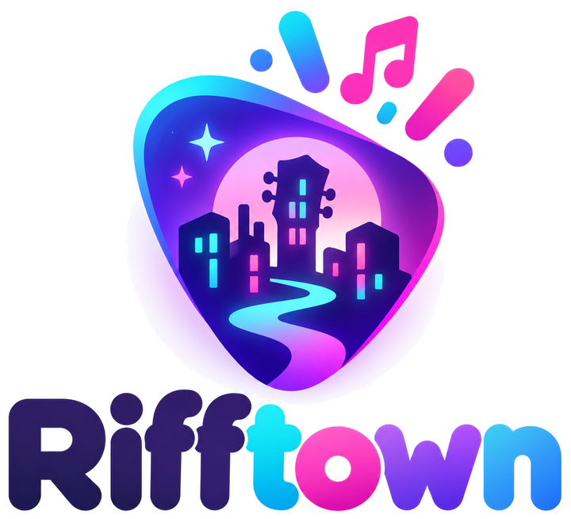
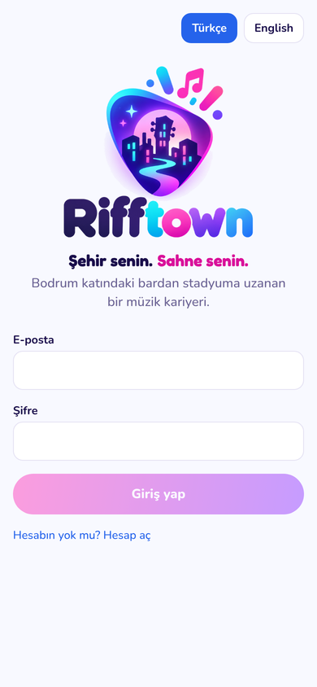
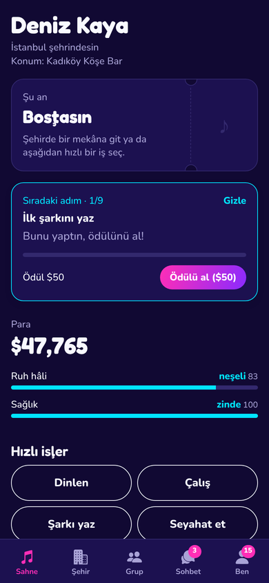
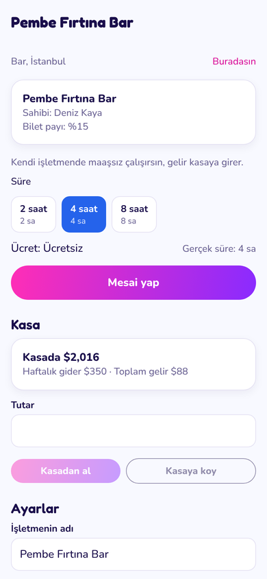
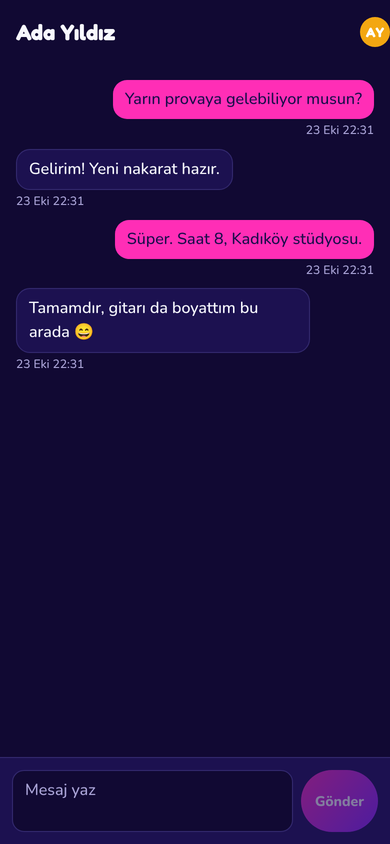

<p align="center"></p>

# Rifftown

*Şehir senin. Sahne senin.* · *Your City. Your Stage.*

Online, gerçek zamanlı bir müzik kariyeri yaşam simülasyonu: iOS ve Android uygulaması, oyun sunucusu ve yönetim paneli. Oyun kuralları ve tüm formüller için [GAME_DESIGN.md](GAME_DESIGN.md) dosyasına bak.

Marka rehberi (logo, renkler, yazı tipleri) için [BRAND.md](BRAND.md) dosyasına bak.

<p align="center">




</p>

Diğer ekran görüntüleri `docs/ekran-goruntuleri` klasöründe.

## Neler var

| Klasör | İçerik |
|---|---|
| `packages/shared` | Oyun dünyası (5 ülke, 15 şehir, mekânlar, dükkân ürünleri, 45 yapay grup, festivaller), beceri ağacı, kelime ölçekleri, konser eleştirileri, kayıt ve satış formülleri, suçlar, başarımlar, evler, rehber görevler, ilişkiler, işletmeler, atölye tarifleri, haftalık görevler, küfür filtresi, kurallar. Sunucu ve uygulama aynı dosyayı kullanır. |
| `server` | API (Fastify + PostgreSQL), zamanlayıcı (oyuncular çevrimdışıyken eylemleri, konserleri, haftalık listeleri, davaları, tahliyeleri, kiraları, işletme giderlerini, banka faizini ve festivalleri sonuçlandırır, oyunun kendi gruplarını yönetir), push bildirimleri, `/admin` yönetim paneli (şikâyetler dahil), `/legal` şartlar ve gizlilik sayfaları, testler |
| `app` | Expo (React Native) mobil uygulama, Türkçe + İngilizce, açık ve karanlık tema |
| `deploy` | Docker Compose kurulumu, otomatik HTTPS (Caddy), tek komutluk kurulum betiği, günlük yedekleme |

## Bilgisayarında çalıştırma

Gerekenler: Node.js 22, PostgreSQL 16.

```bash
npm install

# Veritabanı
createdb rifftown

# Sunucu: GAME_SPEED=60 ile 1 oyun saati 1 dakika sürer, deneme için idealdir
cd server
DATABASE_URL=postgres://localhost:5432/rifftown GAME_SPEED=60 RUN_WORKER=1 npm run dev
```

Uygulama (ayrı bir terminalde):

```bash
cd app
cp .env.example .env     # EXPO_PUBLIC_API_URL değerini bilgisayarının yerel IP'siyle değiştir
npx expo start
```

Telefona **Expo Go** uygulamasını kur ve terminaldeki QR kodu okut. Telefon ve bilgisayar aynı Wi-Fi ağında olmalı. Push bildirimlerini denemek için Expo Go yerine bir geliştirme derlemesi gerekir (`npx eas-cli@latest build --profile development`, ayrıntısı aşağıda). Oyunun geri kalanı Expo Go'da tam çalışır.

Tarayıcıda denemek için: `npx expo start --web`.

### Testler

```bash
createdb rifftown_test
npm test
```

95 test, gerçek bir veritabanına karşı oyunun tüm akışını sınar: kayıt, eylemler, beceri ağacı ve kitapçı, seviye atlama bildirimleri, dükkânlar, hastane, seyahat, şarkı, grup, davet, sohbet, kiralık müzisyenlerle konser ve eleştirisi, meslekler ve terfi, sokak müziği, seçimler ve makam maaşları, VIP avantajları (kesin sayıların gizlenmesi dahil), mağaza bildirimleri ve iadeler, şarkı kaydı, single ve albüm yayını, haftalık satışlar ve listeler, suç ve soruşturma, mahkeme kararları, cezaevi ve kefalet, başarımlar, oyunun kendi grupları, ev ve kira, rehber görevler, profil fotoğrafı ve moderasyonu, özel mesajlar, arkadaşlık, ziyaretçi defteri, hediye, engelleme ve şikâyet, flörtten evliliğe ve evlat edinmeye ilişkiler, ikinci el pazarı, sprey boya ve isim verme, atölyede üretim, araç, evcil hayvan, otel, restoran, banka, dövme ve spor salonu, oyuncu işletmeleri ve çalışanlar, sahne efektleri ve festivaller, haftalık görevler, kayıtta şartlar onayı, hesap silme, küfür filtresi, şikâyet kuyruğu, enerji, ilham ve moodlet'ler, EFSANEVİ konser ve efsaneleşen enstrüman, oyuncular arası takas, kötüye kullanım korumaları (teklifteki yüzük, üretilen eşyanın dükkâna satılması, VIP eşyası hediyesi, el değiştiren işletmede mesai), yönetim paneli, ilk saat dengesi (bar konserinin şöhret ve kâr getirmesi, sahne gelir payları, kulübe kaç konserde çıkıldığı), rehber sonrası hedef, konser raporundaki açıklama, şehirdeki oyuncular, aynı sahnede çakışan konser, ek hesap önlemleri (hesap yaşı, fiyat ve takas parası tavanı, adres başına kayıt sınırı) ve oyun dengesi.

## Ücretsiz test sunucusu (Render + Neon + GitHub Pages)

Test için her şey ücretsiz planlarda çalışır ve `main` dalına her yüklemede kendiliğinden güncellenir:

| Parça | Nerede | Ne zaman güncellenir |
|---|---|---|
| Oyun sunucusu ve zamanlayıcı | Render (ücretsiz web servisi, `render.yaml`) | `server/` ya da `packages/shared/` değişince |
| Veritabanı | Neon (ücretsiz Postgres) | Sunucu açılışta tabloları kendisi günceller |
| Web sürümü | GitHub Pages (`.github/workflows/web.yml`) | `app/` değişince |
| Testler ve Docker derlemesi | GitHub Actions (`.github/workflows/ci.yml`) | Her yüklemede |

Bir kez yapılacaklar:

1. **Neon:** Projede **Connect** düğmesine bas. "Connection pooling" açıkken çıkan adresi (`-pooler` içerir) ve kapalıyken çıkan adresi kopyala.
2. **Render:** New → Blueprint → bu depo. Sorulan değerler:
   - `DATABASE_URL`: Neon'un havuzlu (`-pooler`) adresi
   - `DATABASE_URL_UNPOOLED`: Neon'un havuzsuz adresi (veritabanı güncellemeleri oturum kilidi kullandığı için gerekir)
   - `ADMIN_EMAILS`: yönetici olacak e-posta. Bu adresle kayıt olunca yönetim paneli (`/admin`) açılır.
   - `CONTACT_EMAIL`: oyuncuların göreceği destek adresi
3. **GitHub:** Settings → Pages → Source: **GitHub Actions**. Render adresin `https://rifftown-api.onrender.com` değilse Settings → Secrets and variables → Actions → **Variables** altına `API_URL` olarak yaz.

Web sürümü: `https://<github-kullanıcı-adı>.github.io/Rifftown/`

Ücretsiz planın sınırları: Render sunucusu 15 dakika trafik gelmezse uyur, ilk istek yaklaşık 1 dakika sürer. Uyurken biten eylemler ve konserler uyanınca toplu sonuçlanır, push bildirimleri o arada gitmez. Neon 5 dakika boşta kalınca uyur ve ayda 100 işlem saati verir; sunucu da boştayken uyuduğu için test için yeter. Oyun zamanını hızlandırmak için Render'da `GAME_SPEED` değerini artır (ör. `6`).

Yerelde Neon ile çalışmak için: `neon env pull` (adresleri `.env.local` dosyasına yazar), sonra `npm run dev:server`. Sunucu `.env.local` dosyasını kendisi okur.

## Kendi sunucunda yayına alma

Ayda yaklaşık 5–40 € tutan, en az 2 GB RAM'li bir Ubuntu sunucusu yeterli (Hetzner, DigitalOcean, Contabo vb.).

1. Bir alan adı al ve DNS'te bir alt alan adını (ör. `api.oyunun.com`) sunucunun IP adresine yönlendir (A kaydı).
2. Projeyi sunucuya kopyala (ör. `git clone` ya da `scp`).
3. Proje klasöründe:

   ```bash
   sudo bash deploy/setup.sh api.oyunun.com
   ```

   Betik Docker'ı kurar, güvenlik duvarını ayarlar, rastgele bir veritabanı şifresi üretir, servisleri başlatır, HTTPS sertifikasını alır ve her gece yedek almayı ayarlar.
4. Uygulamadan kayıt ol, sonra kendini yönetici yap:

   ```bash
   cd deploy && docker compose exec api node dist/make-admin.js eposta@adresin.com
   ```

5. Yönetim paneli: `https://api.oyunun.com/admin`. Oyuncu arama, banlama, para düzeltme, sohbet mesajı silme ve genel istatistikler burada.

Güncelleme yüklemek için: yeni kodu sunucuya al ve `cd deploy && docker compose up -d --build`. Veritabanı değişiklikleri açılışta otomatik uygulanır.

Yedekten geri yükleme: `gunzip -c deploy/backups/rifftown-TARİH.sql.gz | docker compose exec -T db psql -U rifftown -d rifftown`

## Mağazalara gönderme

Mac gerekmez; derlemeler Expo'nun bulut servisi EAS'te yapılır.

1. [expo.dev](https://expo.dev) üzerinde ücretsiz bir hesap aç.
2. `app` klasöründe:

   ```bash
   npx eas-cli@latest login
   npx eas-cli@latest init          # proje kimliğini app.json'a yazar; push için gerekli
   ```

3. `app/eas.json` içindeki `EXPO_PUBLIC_API_URL` değerlerini kendi alan adınla değiştir.
4. Telefonda denemek için Android APK: `npx eas-cli@latest build -p android --profile preview`
5. Mağaza derlemesi ve gönderim:

   ```bash
   npx eas-cli@latest build -p all --profile production
   npx eas-cli@latest submit -p ios
   npx eas-cli@latest submit -p android
   ```

   Bunun için Apple Developer (yılda 99 $) ve Google Play (tek seferlik 25 $) hesapları gerekir. İlk iOS derlemesinde EAS, sertifikaları senin yerine oluşturmayı önerir.

Yeni bir Google Play kişisel hesabıyla yayına çıkmadan önce 12 test kullanıcısıyla 14 günlük kapalı test zorunlu. Bu süreyi oyunun dengesini gerçek oyuncularla denemek için kullanabilirsin (`GAME_SPEED=1` ile).

### Mağaza kuralları için yapman gerekenler

Uygulamada mağazaların istediği her şey hazır: kayıtta şartlar ve gizlilik onayı, uygulama içinden hesap silme, küfür filtresi, engelleme, şikâyet ve yönetim panelinde şikâyet listesi. Göndermeden önce:

1. `server/legal/terms.md` ve `server/legal/privacy.md` içindeki köşeli parantezli yerleri (şirket/kişi adı, adres, tarih) doldur ve bir hukukçuya göster. Bunlar taslaktır.
2. `deploy/.env` içine `CONTACT_EMAIL=destek@alanadin.com` yaz. Bu adres şartlarda, gizlilik politikasında ve uygulamanın ayarlar bölümünde görünür.
3. App Store Connect ve Google Play Console'da gizlilik politikası adresi olarak `https://api.oyunun.com/legal/privacy`, hesap silme adresi olarak da aynı sayfayı (Google Play bir web adresi ister; sayfada uygulamadan silme adımları ve e-posta yolu yazıyor) gir.
4. Yaş derecelendirme anketlerinde "kullanıcılar arası iletişim" ve "kullanıcı içeriği" var, "kumar" yok diye işaretle. Oyunda gerçek para ile şans oyunu yok.
5. Şikâyetlere 24 saat içinde bakmak Apple'ın kuralıdır. Yönetim panelini düzenli kontrol et.

## VIP satın almayı açma

VIP satışı RevenueCat üzerinden yapılır. RevenueCat, App Store ve Google Play satın alımlarını tek yerde toplar ve gelir belli bir eşiğe ulaşana kadar ücretsizdir.

1. **Mağazalarda ürünleri tanımla.** App Store Connect ve Google Play Console'da üç ürün aç: `rifftown_vip_1m`, `rifftown_vip_3m`, `rifftown_vip_12m`. Abonelik ya da tek seferlik ürün olabilirler; sunucu ikisini de anlar. Fiyatları mağazada belirlersin, uygulama mağazanın yerel fiyatını gösterir.
2. **RevenueCat'te projeyi kur.** [revenuecat.com](https://www.revenuecat.com) üzerinde bir proje aç, iki mağazayı bağla, üç ürünü içe aktar ve bunları "current" olarak işaretli bir Offering'e ekle.
3. **Uygulamaya anahtarları yaz.** RevenueCat → API keys bölümündeki Apple (`appl_…`) ve Google (`goog_…`) anahtarlarını `app/eas.json` içindeki `EXPO_PUBLIC_REVENUECAT_IOS_KEY` ve `EXPO_PUBLIC_REVENUECAT_ANDROID_KEY` alanlarına yaz.
4. **Sunucuyu bağla.** RevenueCat → Integrations → Webhooks bölümünde:
   - Adres: `https://api.oyunun.com/api/webhooks/revenuecat`
   - Authorization header value: kurulum betiğinin sonunda yazdırdığı bildirim anahtarı (`deploy/.env` içindeki `REVENUECAT_WEBHOOK_SECRET`).
5. **Yeni bir derleme al.** Satın alma Expo Go'da çalışmaz; `npx eas-cli@latest build --profile development` ile geliştirme derlemesi ya da mağaza derlemesi gerekir. Önce mağazaların test hesaplarıyla (Apple sandbox, Google lisans testi) dene.

Anahtarlar girilmemişse uygulamadaki satın alma düğmeleri kapalı kalır ve bunu açıklayan bir mesaj gösterilir. Bu sırada yönetim panelinden oyunculara elle VIP verebilirsin ("VIP ver" düğmesi).

## Mimari notlar

- Tüm hesaplar sunucuda yapılır; uygulama sadece gösterir. Hile için istemciye güvenilmez.
- Süreli eylemler ve konserler veritabanında bitiş zamanıyla tutulur. Zamanlayıcı her 2 saniyede bir vadesi gelenleri işler. Birden fazla zamanlayıcı aynı anda güvenle çalışabilir (`FOR UPDATE SKIP LOCKED`).
- Aynı anda tek eylem kuralı veritabanı düzeyinde de korunur (kısmi benzersiz indeks).
- Bildirimler veritabanına yazılır, zamanlayıcı Expo push servisine toplu gönderir.
- Kesin sayılar VIP'e özeldir ve bu kural sunucuda uygulanır (`server/src/visibility.ts`): VIP olmayanlara giden her yanıtta beceri, kalite, aşinalık, şöhret, ruh hâli ve sağlık değerleri seviye içinde kaba adımlara yuvarlanır. Yeni eklenen ekranlar da kendiliğinden korunur.
- Seçimler zamanlayıcı tarafından açılır ve kapatılır; makam maaşları her oyun günü ödenir.
- Zamanlayıcının her aşaması (eylemler, konserler, adalet, listeler, kira, seçimler, bildirimler) ayrı çalışır; biri hata verirse diğerleri etkilenmez. Her eylem kendi veritabanı işleminde sonuçlanır.
- Profil fotoğrafları veritabanında saklanır (kişi başı en fazla 300 KB) ve `/api/avatars/:id` adresinden uzun süreli önbellekle sunulur.
- Para ve eşya hareketleri (pazar, hediye, işletme kasası, maaş, düğün ücretleri) tek veritabanı işleminde ve karakter satırları her zaman aynı sırayla (id'ye göre) kilitlenerek yapılır; iki istek aynı anda gelse de para ya da eşya çoğalmaz.
- Sunucu ortam değişkenleri: `DATABASE_URL`, `DATABASE_URL_UNPOOLED` (veritabanı güncellemeleri için doğrudan bağlantı; yoksa `DATABASE_URL`), `PG_POOL_MAX`, `ADMIN_EMAILS`, `PORT`, `GAME_SPEED`, `RUN_WORKER`, `WORKER_INTERVAL_MS`, `EXPO_ACCESS_TOKEN`, `REVENUECAT_WEBHOOK_SECRET`, `PUSH_ENABLED`, `RATE_LIMIT`, `LOG_LEVEL`, `NPC` (`0` ise oyunun kendi grupları kapalı), `CONTACT_EMAIL` (şartlarda, gizlilikte ve uygulamada görünen iletişim adresi), `PERMADEATH` (**hassas**, varsayılan kapalı; `1` ise ihmal edilen ve çok yaşlanan karakterler ölür, bkz. GAME_DESIGN.md "Ölüm"), `DECAY` (`0` ise aşinalık çürümesi ve şöhret azalması kapalı), `AGING` (`0` ise karakterler yaşlanmaz), `GIG_SATURATION_HOURS` (şehir doygunluğu penceresi, oyun saati; varsayılan 60, `0` ise kapalı; bkz. GAME_DESIGN.md "Konser hesabı").
- Uygulama ortam değişkenleri: `EXPO_BASE_URL` (web sürümü alt klasörde yayınlanacaksa), `EXPO_PUBLIC_API_URL`, `EXPO_PUBLIC_REVENUECAT_IOS_KEY`, `EXPO_PUBLIC_REVENUECAT_ANDROID_KEY`.
